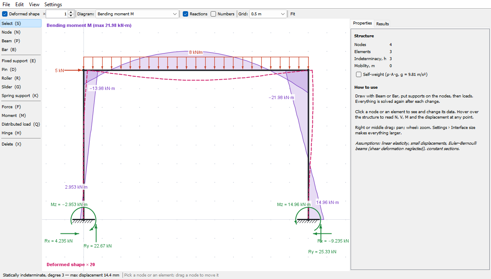
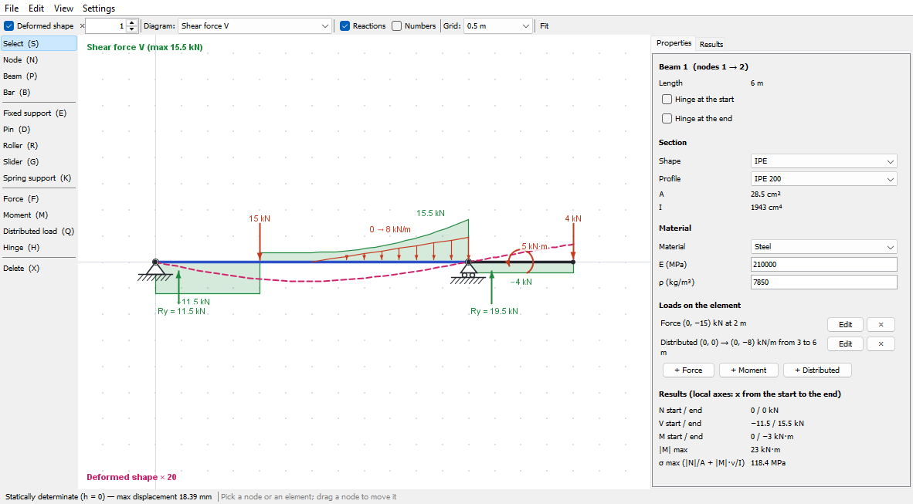
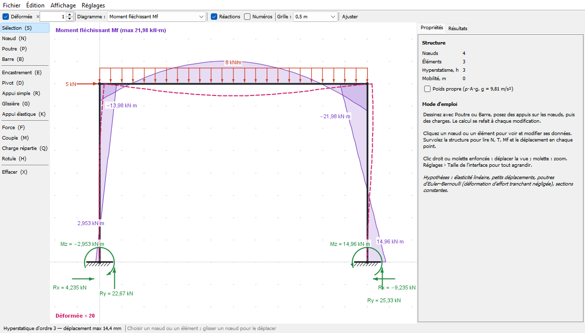
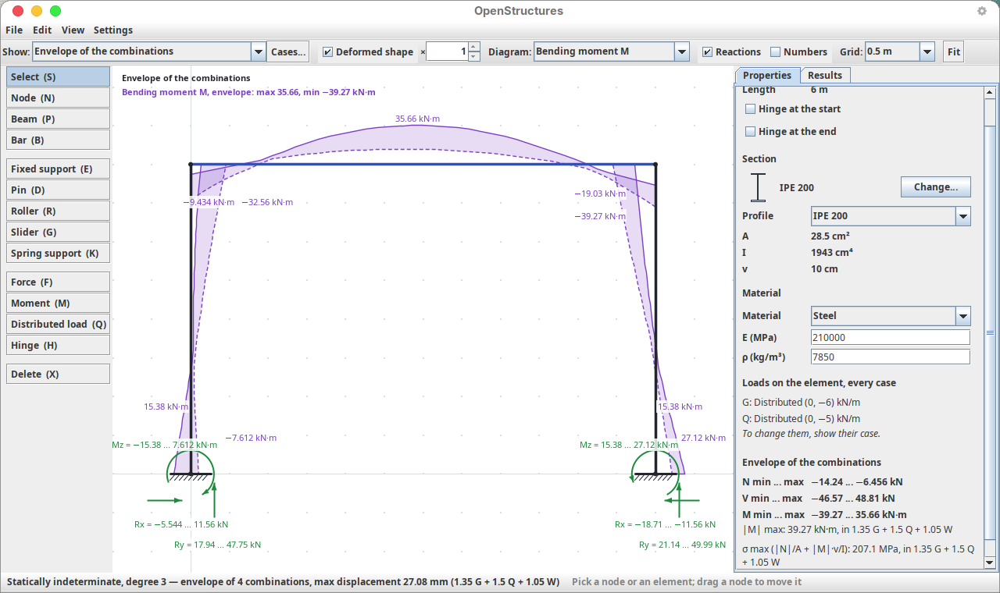
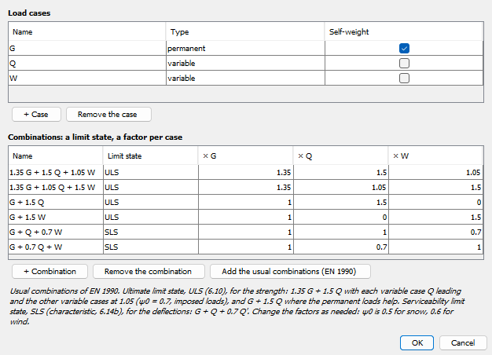
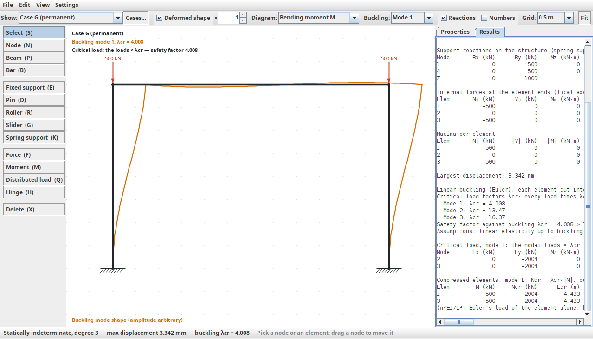
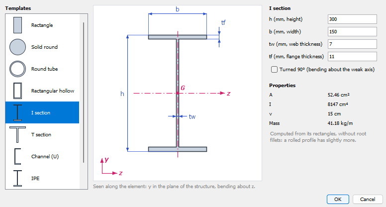
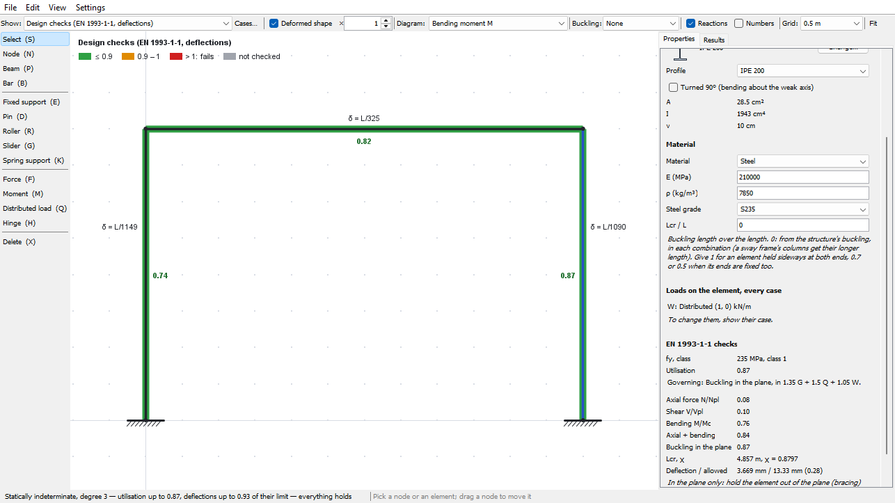

# OpenStructures (proof of concept)

[](https://github.com/aurelientrinder/openstructures/actions/workflows/checks.yml)

A small Résistance des Matériaux application in Java, in the spirit of RDM7's *Ossatures* module: draw plane
beams and trusses, put supports and loads on them, and see straight away how they deform, with the
internal forces (N, V, M), the reactions and the degree of static indeterminacy, then check the steel members
(EN 1993-1-1) and the deflections. Every change is solved again live, including while a node is being dragged.

In English and in French (Settings › Language; it follows the system's language at first). Plain Java 21 +
Swing, no dependencies, no build tool.





<details><summary>En français</summary>



</details>

## Download

From the [latest release](https://github.com/aurelientrinder/openstructures/releases/latest):

| System | File | Then |
| --- | --- | --- |
| Windows | `OpenStructures-…-windows-x64.zip` | unzip, run `OpenStructures.exe` (if Windows warns about an unknown publisher: *More info › Run anyway*) |
| macOS, Apple silicon | `OpenStructures-…-macos-arm64.zip` | unzip; the first time, right-click `OpenStructures.app` › *Open* (it is not signed) |
| Linux | `OpenStructures-…-linux-x64.tar.gz` | extract, run `OpenStructures/bin/OpenStructures` |
| anything with Java 21+ | `rdm.jar` | double-click it, or `java -jar rdm.jar` |

The system packages carry their own Java: nothing else to install.

## Build from source

```bat
run.cmd          :: builds rdm.jar and starts it
build.cmd        :: only builds rdm.jar (then: java -jar rdm.jar [file.rdm], or double-click it)
verify.cmd       :: the solver, the sections and the design checks against closed-form results, and the texts (456 checks)
```

On Linux or macOS (or anywhere with a JDK 21+), without the scripts:

```sh
javac -encoding UTF-8 -d out/classes $(find src -name '*.java')
jar --create --file rdm.jar --main-class rdm.App -C out/classes .
java -jar rdm.jar
# the checks
javac -encoding UTF-8 -d out/test $(find src test -name '*.java') && java -cp out/test rdm.Verify
```

## Use

| Tool (key) | What it does |
| --- | --- |
| Select (S) — *Sélection* | select a node or an element, drag a node |
| Node (N) — *Nœud* | place a node; on an element, cuts it in two. Or type its coordinates |
| Beam (P) / Bar (B) — *Poutre / Barre* | click two points; chains on, Esc or right-click stops. A bar is hinged at both ends. Or type the points |
| Fixed support (E), Pin (D), Roller (R), Slider (G) — *Encastrement, Pivot, Appui simple, Glissière* | click a node (again: removes it). The normal of a roller or slider is set in the properties, and so is an imposed displacement of what it blocks (a support that settles) |
| Spring support (K) — *Appui élastique* | click a node: springs along t, n and in rotation, stiffnesses in the properties |
| Force (F), Moment (M) — *Force, Couple* | click a node, or a point of an element (anywhere along it, no node needed); type the values (kN, kN·m, counter-clockwise positive) |
| Distributed load (Q) — *Charge répartie* | click an element: a load in kN per metre of element, uniform or linear (triangle, trapezoid), on all of it or part, on the global axes or the element's |
| Hinge (H) — *Rotule* | click an element near one end: hinge there |
| Delete (X) — *Effacer* | click a node or an element; Del deletes the selection |

**Typing points.** With Node, Beam or Bar, type a number (or @) and a field opens under the drawing: `x y` is a
point in m, `@dx dy` a point from the last one, `L<a` a length L at a degrees (counter-clockwise from x), and a
length alone goes towards the pointer, as in CAD. Enter places the point exactly (off the grid if need be) and keeps
the field open for the next one; Esc closes it. The numbers are separated by a space or ";" (and "," in English;
in French "2,5" is a decimal).

The keys are the same in both languages. Right or middle drag pans, the wheel zooms. Hover the structure to read
N, V, M and the displacement at that point in the status bar. Ctrl+Z / Ctrl+Y undo and redo. File › Examples has
eleven ready-made structures. An element's loads are listed in its properties, where they can be changed, removed
or added. The structure's properties (nothing selected) switch the self-weight on in a load case: ρ·A·g per
metre of each element, from its material. The Results tab lists every number (displacements, reactions, end
forces, maxima, σ max).

**Load cases and combinations.** Every load, imposed displacement and the self-weight belong to a load case
(G, permanent, to begin with). *Show:*, above the drawing, picks what is drawn and solved: a case, a combination
or the envelope of all the combinations. The load tools put their loads in the case shown, and ask for one when a
combination or the envelope is shown; the properties change the loads of the case shown. *Cases…* (Edit › Load
cases and combinations, Ctrl+L) adds, renames and removes cases (permanent or variable, with or without the
self-weight) and combinations, each for a limit state (ULS for the strength, SLS for the deflections) with a factor
per case, and adds the usual ones of EN 1990: at the ULS (6.10), 1.35 G + 1.5 Q with each variable case leading in
turn and the others at 1.05 (ψ0 = 0.7), and G + 1.5 Q; at the SLS (characteristic, 6.14b), G + Q + 0.7 Q'. A combination draws its
loads factored and is solved as one loading (the structure is linear: the same as the factored sum of its cases).
The envelope solves every combination and draws the largest and the smallest N, V or M along each element
(solid and dashed), the reactions' ranges, and in the properties and the Results tab the extremes with the
combination they come from. The text and CSV exports follow what is shown. File › Examples › *Portal frame:
load cases G, Q, W and their combinations* has the self-weight and a permanent load (G), an imposed load (Q) and
wind (W).





In French the shear force and the bending moment are written T and Mf, as in French courses; in English V and M.

**Buckling.** *Buckling:*, above the drawing, computes the linear (Euler) buckling of the case or combination shown,
as RDM's *Flambement*, and draws mode 1, 2 or 3 on the structure instead of the deformed shape, the diagram and the
reactions. Every load times the critical load factor λcr (*coefficient de charge critique* λc) is the critical
load: λcr of mode 1 is the safety factor against buckling, written under the view's title, in red below 1. The
normal forces of the linear solution make the geometric stiffness, and the λcr are the eigenvalues of
K φ = λ (−K_g) φ; frames, columns and truss bars alike (a bar buckles alone, between its hinges). The Results tab
and the text export list the modes' λcr, the critical load on the nodes, and for each compressed element its
critical load Ncr = λcr·|N|, its buckling length Lcr = π√(EI/Ncr) (Lf in French), its slenderness and Euler's load
of the element alone, hinged at both ends; the properties give the same for the selected element. With the
envelope, the combination with the smallest λcr is shown. The CSV export writes the modes' shapes. Each element is
cut into 8 for the geometric stiffness (fewer past 25 elements), so λcr comes out a little above the exact value:
by 0.003 % for a column pinned at both ends, 0.05 % for one fixed at both ends. Only in the plane: out-of-plane and lateral-torsional
buckling are not checked. File › Examples has *Euler's column* (λcr = 1.6) and a *portal frame* that sways
(λcr = 4); the *Warren truss* buckles at its end diagonals.



**Sections.** An element's properties show its section, drawn; *Change…* opens the templates: rectangle, solid
round, round tube, rectangular hollow, I, T, U (channel), the steel catalogues (IPE, HEA, HEB, UPN, and the
hollow SHS, RHS, CHS), or A, I and v typed in. The chosen one is drawn to scale with its dimensions, its centroid G
and its bending axis z; its area, inertia, extreme fibre and mass per metre follow as the dimensions are typed. A
section can be turned 90° to bend about its weak axis. Asymmetric sections (T, turned U) are taken about their
centroid, with v on the side furthest from it, for σ.

The rolled sections' A, I and Wel, about both axes, are those printed in the ArcelorMittal sales programme 2024-1
(dimensions to EN 10365), and v = I / Wel. The hollow sections are hot-finished (EN 10210), in the sizes of the
Steel for Life Blue Book, with A and I from the formulae of EN 10210-2 Annex A (which its tables are computed
from). The sources are cited in `src/rdm/model/Catalogue.java`; `Verify` checks rows against them.



**Design checks.** *Show: Design checks* colours every element by its utilisation (green up to 0.9, orange up to 1,
red beyond, grey when not checked), writes it beside the element, and writes each span's deflection as L/…. The
properties give an element's details and the Results tab every number; the CSV export has a row per element.

- **Strength, EN 1993-1-1, under the ULS combinations**, for the steel elements, γM0 = γM1 = 1. The grade (S235,
  S275, S355) is in the element's properties, fy following the thickness (Table 3.1). Along each element, where N,
  V or M may peak: the section's class (Table 5.2), N/Npl, V/Vpl (6.2.6), M/Mc with Wpl in class 1 and 2 and Wel in
  class 3, reduced where V > Vpl/2, and N/Npl + M/Mc (6.2.1 (7), conservative). Class 4 sections are not checked.
- **Flexural buckling in the plane** (6.3.1, and 6.61 with Annex B's kyy, Cmy = 1): the buckling length is k L
  when k is given in the element's properties, else it comes from the structure's buckling in each combination
  (Ncr = λcr·N Ed), so that a sway frame's columns get their longer length; a truss bar at most its length.
- **Deflections, under the SLS combinations**: each span (a straight run of elements through nodes where nothing
  else meets) from the line through its ends, at most L/300 (the limit is in the structure's properties); a
  cantilever from its fixed end, at most 2 L/300.

Without a combination of a limit state, its checks take the loads as given, every case at 1 (and say that the
strength was then checked under loads not factored). Not checked: buckling out of the plane and lateral-torsional
buckling (hold the members out of the plane), shear buckling of slender webs (flagged), holes and connections.
`SteelSection`'s Wpl and Av agree with the ArcelorMittal and EN 10210 tables (IPE, HEA, HEB, UPN, SHS, RHS, CHS),
which `Verify` checks.



**File › Export** saves the drawing as it is on screen (without the grid) as a PNG image or an SVG vector
drawing, the Results tab as text, and the diagrams as a CSV table for a spreadsheet: points along every element
(both sides of each jump) with N, V, M and the displacement. The CSV uses ";" and decimal commas in French, ","
and points in English.

**Settings › Interface size** scales everything (menus, panels, fonts and the drawing) from 100 % to 300 %, or
leaves it to the system's display scale. **Settings › Language** picks English, French or the system's language.
Both are kept between runs and apply when the app starts again: it offers to restart at once, keeping the
drawing. A size can also be given for one run: `java -Dsun.java2d.uiScale=1.5 -jar rdm.jar`.

Units: lengths in m, forces in kN, section dimensions in mm (A/I/v typed in: cm), E in MPa, ρ in kg/m³,
imposed displacements in mm and mrad, spring stiffnesses in kN/m and kN·m/rad.
Files: `.rdm`, a plain text format described in `src/rdm/io/StructureFile.java` (version 5 adds the limit states,
grades, buckling lengths and the deflection limit; version 4 has the load cases and combinations; older files open
with every load in case G).

## How it works

- `rdm.model` — `Structure` (nodes, elements, load cases, combinations, the EN 1990 ones generated), `LoadCase`
  (permanent or variable, self-weight or not), `Combination` (ULS or SLS, a factor per case), `Loading` (the factors the
  solver applies), `Node` (support, springs, a `NodeLoad` per case: forces and imposed displacement), `Element`
  (hinges, section, material, steel grade, buckling length, loads), `ElementLoad` (force, couple, linear distributed load, each in a case,
  positions as fractions of the length), `Support`, `Section` (templates; the thin-walled ones computed from
  their rectangles), `Material`, `Examples`.
- `rdm.solver` — displacement method (`Solver`): 3 unknowns per node (ux, uy, θz), Euler–Bernoulli elements
  with hinged ends condensed out (`ElementResult`), skewed supports solved in their own frame, a semi-definite
  Cholesky (`Cholesky`) whose null pivots are the mechanism's degrees of freedom. `ElementResult` gives the
  torseur de cohésion and the deflection anywhere along an element, exactly (not interpolated): the loads'
  equivalent nodal forces come from the Hermite shape functions, N, T, Mf and the deflection from closed-form
  integrals of what lies before the cut. Imposed displacements go to the right-hand side; springs add to the
  diagonal. A case or a combination is one `Loading`, solved once; `Envelope` solves every combination and keeps
  the extreme N, V, M along each element (at sample points and each combination's moment extrema) and the
  extreme reactions. `Buckling` cuts each element into sub-elements, adds their geometric stiffness from N, reduces
  K φ = λ (−K_g) φ with the Cholesky factor to a symmetric eigenproblem, solved by `Eigen` (Householder, then QL);
  a hinged end keeps a rotation of its own.
- `rdm.design` — `SteelSection` (a section for EN 1993-1-1: Wpl, Av, its plates and their class, its buckling
  curve) and `Design`, which solves the ULS and SLS combinations, checks every element along it, and cuts the
  structure into spans for their deflection.
- `rdm.i18n` — the texts: `En` and `Fr` map the same keys to each language, `Tr.tr(key, args…)` looks them up.
  To add a language, copy `Fr.java`, translate it and add it to `Tr.Lang`; `Verify` checks that every language
  has every key with the same arguments.
- `rdm.ui` — the Swing window (`MainFrame`, which also holds undo and solves after every edit), the drawing
  (`StructureCanvas`, `Symbols`), the properties panel (`Inspector`) and the text report (`Report`).

What comes from Schemes (schema-cinematique.com):
- **Supports.** The supports are the liaisons of `hyperstatism.ts` `jointBasis` with the bâti, cut down to the
  plane: each is defined by the components it transmits. An internal pivot becomes a hinge.
- **Hyperstatism.** Same definition as Schemes (unknowns − rank of the equilibrium equations, mobility = the
  nullity), computed here from the stiffness matrix: h = Σ(3 − hinges) + springs − free unknowns + m.
- **Torseur de cohésion.** Same convention as `cohesion.ts`: action of the part after the cut on the part before,
  N > 0 in traction, dMf/dx = −T.
- **Sections and materials.** The list of `Section`/`mass.ts` and its densities, with E added.
- **Drawing.** The ISO 3952 drawing of the bâti and the pivot from `symbols.tsx`, and the encastrement turned to
  face its elements (`orient.ts`).

Hypotheses (also shown in the app): linear elasticity, small displacements, no shear deformation, constant
sections.

## Not yet

Thermal loads, buckling out of the plane and lateral-torsional buckling, class 4 (effective) sections, 3D, shear
deformation (Timoshenko), other catalogues (UB, UC, W…), angles (their principal axes are inclined), quasi-permanent
and accidental combinations, other materials' design (timber, concrete, aluminium), printing.

## Contributing

Issues and pull requests are welcome, translations too (see `rdm.i18n` above). [CONTRIBUTING.md](CONTRIBUTING.md)
says how to build, run the checks and submit a change. Every push and pull request runs `test/rdm/Verify.java` on Linux, Windows
and macOS (`.github/workflows/checks.yml`); a change to the solver should come with a check against a closed-form
result. Pushing a tag `vX.Y.Z` builds the packages above and publishes the release (`.github/workflows/release.yml`).

## Licence

MIT, see [LICENSE](LICENSE). Use it, change it, share it.
